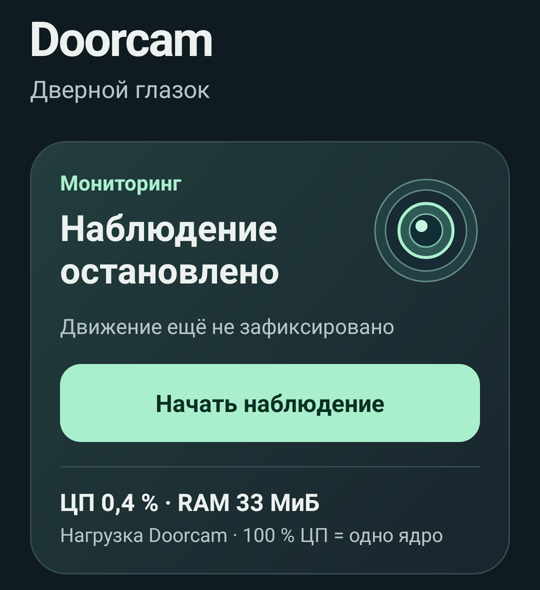
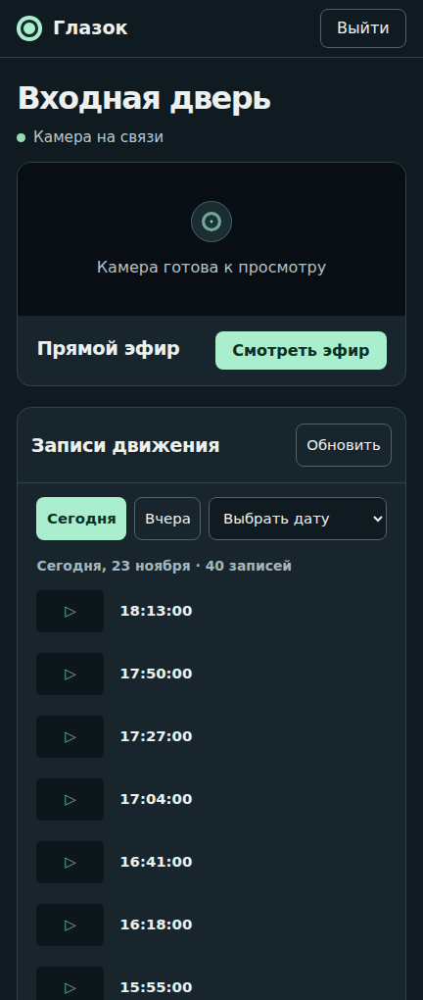

# Doorcam — дверной глазок на Android

Установленный за дверным глазком Android-телефон записывает видео при движении. В домашней сети эфир и архив можно открыть прямо с телефона в браузере. Для удалённого просмотра есть сайт и Telegram-бот, который присылает короткий MP4 для просмотра в чате и ссылку на полную запись.

Полные записи хранятся в приватной папке приложения на телефоне. Cloudflare Worker обслуживает сайт и бота, проверяет пользователей и помогает браузеру установить WebRTC-соединение с камерой. При настроенном TURN он служит запасным маршрутом для видео. Доставленные клипы остаются в переписке Telegram.

Уведомление приходит, когда готов первый фрагмент с движением. После окончания события бот заменяет видео в том же сообщении полной записью, если движение длилось до двух минут и MP4 помещается в 24 МиБ. Для более длинных записей подпись направляет в архив. Кнопка «Посмотреть запись» открывает архив события на телефоне. Временный MP4 для Telegram удаляется после попытки отправки.

## Скриншоты

| Мониторинг на Android | Веб-просмотр и архив |
| --- | --- |
|  |  |

На снимке веб-архива показаны демонстрационные записи.

## Установка на телефон

Приложение поддерживает Android 8.0 (API 26) и новее. Для сборки установите JDK 17, Android SDK Platform 34 и Build Tools 34.0.0. Задайте путь к SDK в `ANDROID_HOME` или через `sdk.dir` в файле `android/local.properties`.

```sh
cd android
./gradlew :app:assembleDebug
adb install -r app/build/outputs/apk/debug/app-debug.apk
```

APK также можно скопировать на телефон и открыть для установки. Разрешите доступ к камере и нажмите «Начать наблюдение», пока приложение открыто. После перезагрузки телефона запустите наблюдение вручную. На Meizu разрешите приложению фоновую работу в настройках энергосбережения Flyme.

## Настройки приложения

Параметры камеры и подключения находятся на вкладке «Настройки». Схема экранов и правила оформления описаны в [паттерне Android-интерфейса](docs/android-ui.md).

- **Камера.** Выберите объектив, направленный в глазок. При первом запуске приложение предпочитает основную камеру.
- **Чувствительность движения.** Начните с 50 %. Повысьте значение, если камера пропускает движение, или понизьте его, если запись часто запускается без прохода людей.
- **Зона движения.** Во время наблюдения откройте «Настроить зону движения» и выставьте четыре границы по предпросмотру. Пройдите перед глазком и проверьте индикатор «Движение в зоне». Границы сохраняются сразу. Кнопка «Весь кадр» сбрасывает зону.
- **Лимит видеоархива.** По умолчанию 1024 МиБ, допустимый диапазон от 64 до 32 768 МиБ. При достижении лимита приложение освобождает место, удаляя старые записи.
- **Удалённый доступ.** Укажите HTTPS-адрес сайта Doorcam и ключ устройства из настройки Worker. Для работы только по Wi-Fi оставьте оба поля пустыми.

Чтобы поменять камеру, чувствительность, лимит или удалённый доступ, остановите наблюдение, измените поля и снова нажмите «Начать наблюдение». Приложение сохраняет эти параметры при запуске.

## Просмотр дома по Wi-Fi

1. Подключите телефон с камерой и устройство для просмотра к одной домашней сети Wi-Fi. Для локального просмотра оставьте поля «Адрес сайта Doorcam» и «Ключ устройства» пустыми.
2. Запустите наблюдение. Откройте в браузере HTTP-адрес из раздела «Просмотр по Wi-Fi» на телефоне. Введите логин `viewer` и пароль из того же раздела.
3. Нажмите «Смотреть эфир» или выберите событие в разделе «Записи движения». События в списке сгруппированы по дням. В архиве можно выбрать фрагмент, перемотать его в плеере или скачать как MP4.

Локальная страница работает по HTTP. Пароль и видео передаются без шифрования, поэтому используйте её в доверенной домашней сети. Для эфира браузеру нужна поддержка H.264 в Media Source Extensions.

## Удалённый просмотр и Telegram

Потребуются Node.js 24, аккаунт Cloudflare с поддоменом workers.dev и Telegram-бот. Команды ниже выполняются из каталога `cloud`.

1. Создайте бота через `/newbot` в BotFather. Сохраните выданный токен.
2. В Cloudflare выберите имя Worker и свой поддомен workers.dev. В `wrangler.toml` задайте имя Worker, `PUBLIC_ORIGIN` (его полный HTTPS-адрес без завершающего слеша), `OWNER_ID` (ваш числовой Telegram ID в кавычках) и `OIDC_CLIENT_ID`. Последний выдаёт BotFather в **Bot Settings → Login Widget**. В этом же разделе зарегистрируйте адрес сайта и точный адрес обратного вызова `https://ВАШ-ХОСТ/auth/callback`, затем выберите подпись RS256. [Telegram Login](https://core.telegram.org/bots/telegram-login)
3. Для просмотра через мобильную сеть создайте TURN key в Cloudflare Realtime. Впишите его ID в `TURN_KEY_ID`, а связанный API token сохраните для следующего шага. При пустом `TURN_KEY_ID` используется только прямое соединение, его доступность зависит от обеих сетей. [Cloudflare TURN](https://developers.cloudflare.com/realtime/turn/generate-credentials/)
4. Создайте в `cloud` файл `.dev.vars` с правами только для владельца. Добавьте значения ниже. Для `DEVICE_KEY` и `WEBHOOK_SECRET` сгенерируйте по отдельной случайной строке командой `openssl rand -hex 32`. Git игнорирует этот файл.

```dotenv
BOT_TOKEN=токен_от_BotFather
OIDC_CLIENT_SECRET=секрет_Login_Widget
DEVICE_KEY=случайный_ключ_для_Meizu
WEBHOOK_SECRET=отдельный_случайный_секрет
TURN_API_TOKEN=токен_TURN_от_Cloudflare
```

5. Опубликуйте Worker с секретами и зарегистрируйте его адрес в Telegram. Замените адрес в третьей команде своим. Для последующих обновлений сайта и серверной логики достаточно повторить deploy.

```sh
npx wrangler@4 login
npx wrangler@4 deploy --secrets-file .dev.vars
node --env-file=.dev.vars scripts/register-webhook.mjs https://ИМЯ.ПОДДОМЕН.workers.dev
```

6. Откройте личный чат с ботом и отправьте `/start`. Остальные зрители тоже отправляют `/start`. Владелец одобряет заявку кнопкой в чате с ботом и отзывает доступ из списка `/list`. Также доступны команды `/allow ID`, `/revoke ID` и `/status` для состояния захвата. Бот сообщает владельцу о длительном сбое и восстановлении. Из Telegram кнопка «Посмотреть запись» открывает Mini App. При прямом переходе на сайт доступен вход через Telegram.
7. В Android-приложении укажите HTTPS-адрес Worker и тот же `DEVICE_KEY`. Если наблюдение уже работает, остановите его перед изменением настроек и запустите снова после сохранения. При обновлении существующей установки сначала обновите Worker, затем установите новый APK.

## Проверка на месте

- Пройдите мимо глазка, воспроизведите клип в Telegram и откройте кнопку под ним. Затем проверьте раздел «Записи» и живое видео из мобильной сети.
- Погасите экран Meizu и повторите проверку после длительной работы. Подберите чувствительность при включении света в подъезде и проверьте нагрев телефона.
- Выключите Wi-Fi камеры и пройдите перед ней. После восстановления сети проверьте появление записи и уведомления.
- Отзовите доступ у второго зрителя во время просмотра. Проверьте прекращение передачи и повторный вход.
- Время хранения архива определяется свободной памятью и заданным лимитом. При отключённом Meizu уже доставленные клипы доступны в Telegram. Полную запись можно открыть, когда телефон снова подключится.

## Тесты

Из каталога `android` запустите `./gradlew :app:testDebugUnitTest :app:lintDebug`. Из каталога `cloud` запустите `node --test test/*.test.mjs` для проверки серверной логики и протокола передачи видео.
